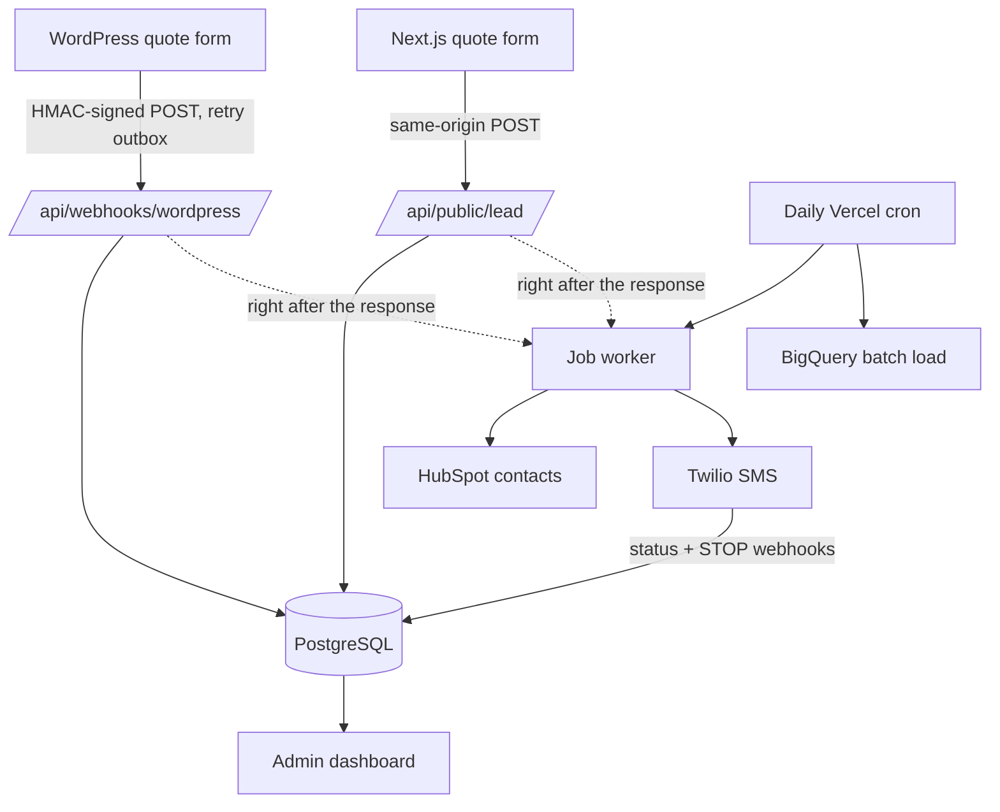
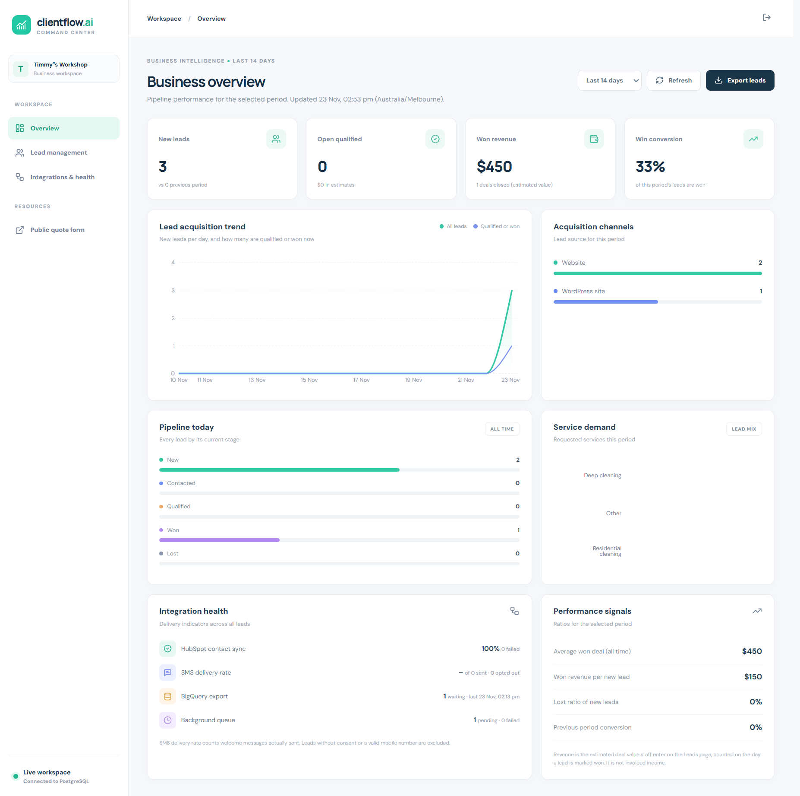
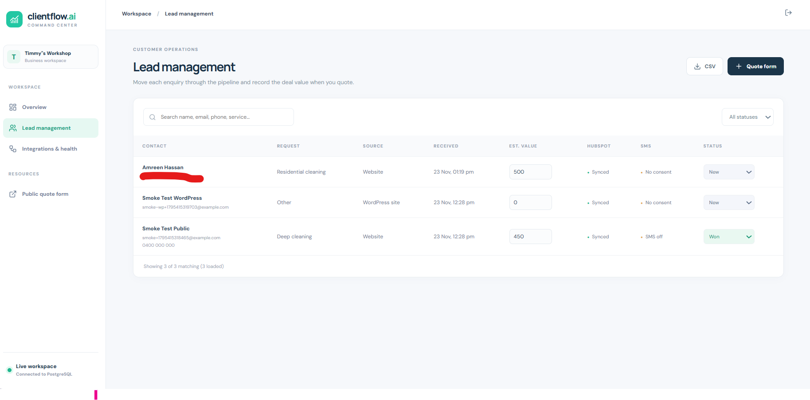
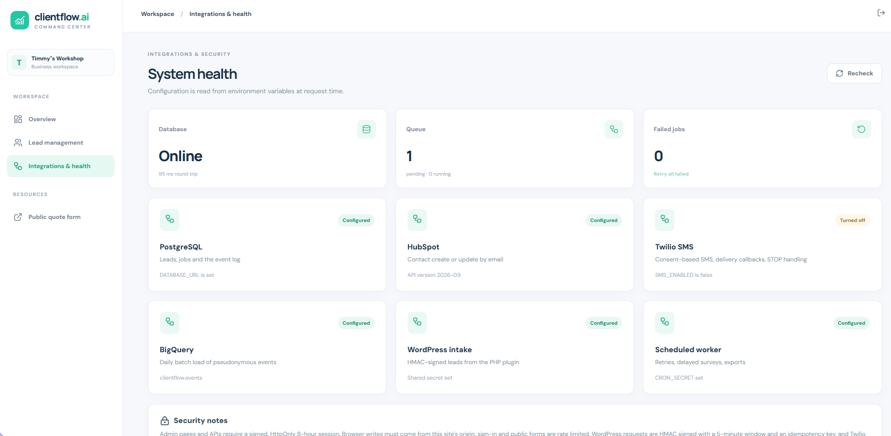
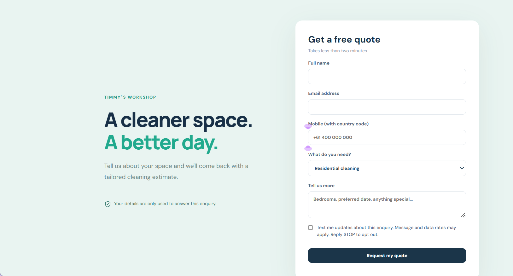
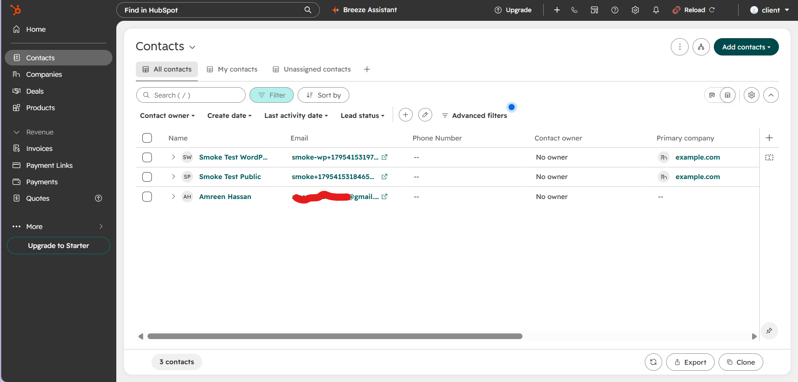
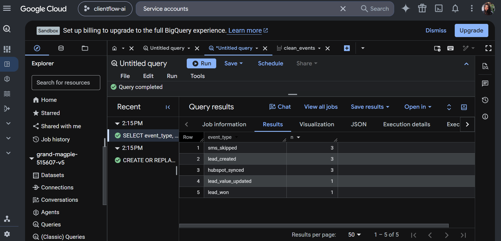
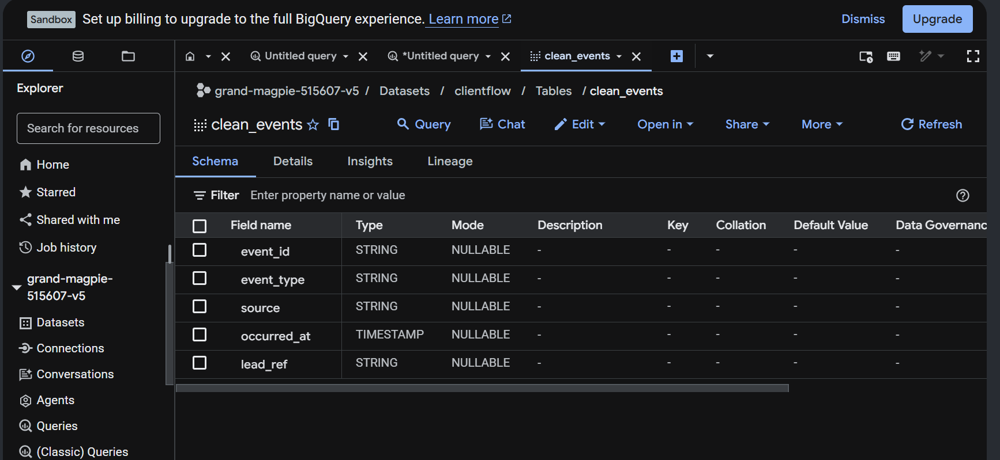
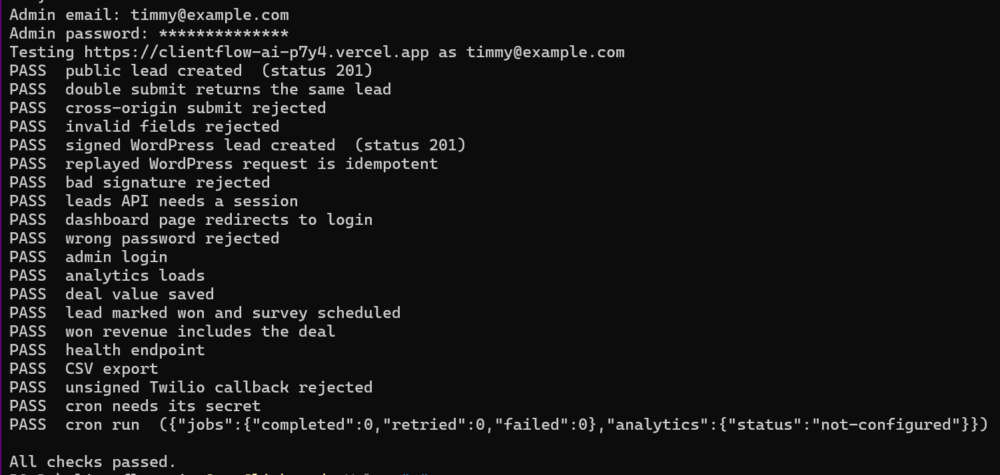

# ClientFlow AI

Lead capture and customer operations for a service business. A Next.js app on Vercel holds the admin dashboard, the public quote form and all APIs. A small WordPress plugin adds the same quote form to a WordPress site. Leads are stored in PostgreSQL, synced to HubSpot, followed up by Twilio SMS (only with consent), and exported to BigQuery for historical reporting.

**Live deployment:** https://clientflow-ai-p7y4.vercel.app

The dashboard is private, so the root URL opens the sign-in page. The public quote form is at [/quote](https://clientflow-ai-p7y4.vercel.app/quote). Anything submitted there is stored as a real lead, so please use test details.

Built with Next.js 15 (App Router, TypeScript), PostgreSQL on Neon, the HubSpot CRM API, Twilio, BigQuery and a PHP 8 WordPress plugin.

## Deployment status

| Part | On the live deployment |
|---|---|
| Next.js app on Vercel | Running, admin sign-in enabled (`DEMO_MODE=false`) |
| PostgreSQL (Neon) | Connected, migrations applied |
| HubSpot | Connected with a Service Key; leads sync as contacts |
| BigQuery | Connected through the BigQuery Sandbox; events load into `clientflow.events` |
| Twilio SMS | Built and tested with signed webhooks, switched off here (`SMS_ENABLED` unset) |
| WordPress plugin | Built and tested against the real PHP plugin; no WordPress site attached here |
| Smoke test | All 20 checks pass against the live URL |

SMS is off on this deployment because the main Bangladeshi networks block texts from unregistered senders and don't support replies, so the STOP flow can't be tested from here. Everything else in the table above was checked against the live URL.

## How it works



A new lead is written to PostgreSQL in one transaction together with its event and two jobs (HubSpot sync and welcome SMS). The API answers the visitor immediately and then runs those two jobs in the background with Next.js `after()`, so the customer usually gets the SMS within seconds. The daily cron is a safety net: it retries failed jobs with exponential backoff, sends survey texts that are due, and loads new events into BigQuery.

Every request that creates a lead carries an idempotency key. Double clicks, browser retries, WordPress outbox retries and replayed webhook requests all return the original lead instead of creating a second one.

## Screenshots

All screenshots are from the live deployment. Personal contact details are covered.

### Business overview

Lead counts, won revenue, win conversion, the acquisition trend, pipeline stages and integration health for the last 14 days.



### Lead management and system health

<table>
  <tr>
    <td width="50%"></td>
    <td width="50%"></td>
  </tr>
  <tr>
    <td>Each lead shows its source, estimated deal value, HubSpot sync status, SMS consent and stage.</td>
    <td>Integration status is read from environment variables at request time. Twilio is shown as turned off.</td>
  </tr>
</table>

### Public quote form

The form visitors fill in. SMS updates are opt-in, and the consent text mentions STOP.



### HubSpot sync

Leads from the website and the signed WordPress endpoint, created as HubSpot contacts by the background worker.



### BigQuery export

<table>
  <tr>
    <td width="50%"></td>
    <td width="50%"></td>
  </tr>
  <tr>
    <td>Events loaded by the worker, counted by type through the deduplicating <code>clean_events</code> view.</td>
    <td>The exported schema. Only a hashed <code>lead_ref</code> identifies a lead, with no names, emails or phone numbers.</td>
  </tr>
</table>

### Smoke test

`npm run test:smoke` against the live URL: intake, duplicate protection, origin and signature checks, login, deal values, the won-to-survey flow, CSV export and cron protection. This run was taken before BigQuery was connected, which is why the last line reports it as not configured.



## Preview in demo mode

Requires Node 20.12 or newer.

```bash
npm install
cp .env.example .env.local      # DEMO_MODE=true is already set
npm run dev
```

Open http://localhost:3000. Demo mode shows about 180 days of generated sample data, needs no database or accounts, is read-only, and rejects real form submissions. The dashboard and the leads table are computed from the same sample records, so their numbers agree.

Pages: `/` dashboard, `/leads` lead management, `/settings` integrations and health, `/quote` public quote form, `/login`, `/survey/<token>`.

## Deploying to Vercel

### 1. Database

Create a managed PostgreSQL 13+ database (Neon and Supabase both work). Copy the pooled connection string with TLS, for example a Neon host ending in `-pooler` with `?sslmode=require`. Serverless functions open many short connections, so the pooled endpoint matters.

Run the migrations once from your computer. Use the unpooled (direct) connection string for this step:

```bash
DATABASE_URL="postgresql://..." npm run db:migrate
```

The runner records applied files in `schema_migrations`, so running it again is safe. Add new schema changes as `db/migrations/002_*.sql` and so on.

### 2. Secrets

```bash
openssl rand -hex 32                       # AUTH_SECRET
openssl rand -hex 32                       # CRON_SECRET
openssl rand -hex 32                       # WORDPRESS_WEBHOOK_SECRET
npm run auth:hash -- "a long unique admin password"   # ADMIN_PASSWORD_HASH
```

On Windows without OpenSSL, `node -e "console.log(require('crypto').randomBytes(32).toString('hex'))"` gives the same kind of value. The admin password needs at least 14 characters. Passing it on the command line leaves it in your shell history, so clear that afterwards or call `node scripts/hash-password.mjs` from a script that reads the password without echoing it.

### 3. Project

Import the repository in Vercel as a Next.js project and add the variables from `.env.example` under Project Settings, Environment Variables. At minimum set `DEMO_MODE=false`, `DATABASE_URL`, `APP_URL` (your exact public https URL, no trailing slash), `AUTH_SECRET`, `ADMIN_EMAIL`, `ADMIN_PASSWORD_HASH`, `CRON_SECRET` and `BUSINESS_TIMEZONE`. Variables starting with `NEXT_PUBLIC_` are built into the browser code, so they can't be marked Sensitive and need a redeploy to change. Deploy.

`vercel.json` schedules `/api/cron/process` once a day at 00:00 UTC, which every Vercel plan allows. New leads don't wait for it. If you want surveys and retries to run more often, use a more frequent schedule on a paid plan or call the endpoint from any scheduler with the `Authorization: Bearer <CRON_SECRET>` header. See https://vercel.com/docs/cron-jobs.

### 4. Check the deployment

```bash
BASE_URL=https://your-app.vercel.app ADMIN_EMAIL=... ADMIN_PASSWORD=... \
WORDPRESS_WEBHOOK_SECRET=... CRON_SECRET=... npm run test:smoke
```

The smoke test runs 20 checks: intake, duplicate protection, origin and signature rejection, login, deal values, the won-to-survey flow, analytics, CSV export and cron protection. It creates two leads named "Smoke Test ...", which you can mark as lost afterwards.

If sign-in fails with "Invalid origin", `APP_URL` doesn't match the address in the browser. It must include `https://` and have no trailing slash.

## WordPress plugin

1. In WordPress go to Plugins, Add New, Upload Plugin and upload `clientflow-leads.zip` (or copy `wordpress/clientflow-leads` into `wp-content/plugins/`). It needs normal PHP 8.0+ hosting with plugin uploads allowed; it does not run on Vercel, and WordPress.com only allows custom plugins on its Business plan and above. To rebuild the ZIP: `cd wordpress && zip -r clientflow-leads.zip clientflow-leads`.
2. Add to `wp-config.php` above the "stop editing" line:

   ```php
   define('CLIENTFLOW_API_URL', 'https://your-app.vercel.app');
   define('CLIENTFLOW_WEBHOOK_SECRET', 'the same value as WORDPRESS_WEBHOOK_SECRET');
   ```

3. Activate "ClientFlow Lead Capture" and put `[clientflow_quote]` on your contact page.

Submissions are checked against a WordPress nonce and a honeypot, sanitised, and sent server to server with `HMAC-SHA256(timestamp + "." + body)`. The app rejects signatures older than five minutes. If the app is down, returns a server error, or the secret is wrong, the plugin stores the enquiry in its own outbox table and tells the visitor it was received. WP-Cron retries every 15 minutes with growing gaps, for up to 20 attempts. Tools, ClientFlow in the WordPress admin shows the queue and has a "Retry now" button, and an admin notice appears while anything is waiting. WP-Cron only runs when the site gets visits; on quiet sites, trigger `wp-cron.php` from a real cron job. Deleting the plugin removes its table.

Queued enquiries contain contact details until they are delivered, so include the WordPress database in your privacy notice.

## HubSpot

HubSpot no longer allows new legacy private apps (creation was switched off on 26 October 2026 for existing accounts). Use a Service Key instead. In HubSpot, open Development, then Keys, then Service keys (also under Settings, Integrations), create a key with the `crm.objects.contacts.read` and `crm.objects.contacts.write` scopes, and put it in `HUBSPOT_ACCESS_TOKEN`. References: https://developers.hubspot.com/changelog/service-keys and https://developers.hubspot.com/changelog/legacy-private-app-creation-sunset.

The worker searches contacts by email, then updates the match or creates a new contact. If a create races with another request (HTTP 409), it updates the existing contact instead. Rate limits and server errors are retried; rejected tokens fail immediately so you can fix them and press "Retry all failed" on the settings page. Leads captured before HubSpot was configured are marked "Not configured" and re-queued on the next worker run once the token is added.

Requests use HubSpot's date-versioned paths (`/crm/objects/2026-09/contacts`). To also store the service and lead source, create custom contact properties in HubSpot and set their internal names in `HUBSPOT_PROPERTY_SERVICE` and `HUBSPOT_PROPERTY_SOURCE`.

## Twilio SMS

1. Set `TWILIO_ACCOUNT_SID`, `TWILIO_AUTH_TOKEN`, and either `TWILIO_MESSAGING_SERVICE_SID` (recommended) or `TWILIO_FROM`. Make sure `APP_URL` is exact, because Twilio signatures are computed over the full URL.
2. Set `SMS_ENABLED=true`.
3. In Twilio, set the incoming message webhook of your number or Messaging Service to `https://your-app/api/webhooks/twilio/inbound` (HTTP POST). Status callbacks to `/api/webhooks/twilio` are set automatically on every message.

A text is only sent when the person ticked the consent box, gave a mobile number that normalises to E.164 (for example `+61 400 000 000`), and has not replied STOP. Numbers in local format are kept for staff but get no SMS. Every request to both webhooks is checked with Twilio's signature validator. Status updates that arrive out of order never move a message backwards (a late "sent" cannot overwrite "delivered").

When someone replies STOP, Twilio sends its own confirmation and the inbound webhook stores a hash of the number in `sms_suppressions` and turns off consent on that person's leads. Replying START lifts the block, but a new enquiry still needs the consent box ticked. Each lead gets at most one welcome text and one survey text.

You still need an eligible sender, any country or carrier registration your destination requires (for example A2P 10DLC in the US, or a registered alphanumeric sender ID for Grameenphone, Robi and Teletalk in Bangladesh), and a funded account. Trial accounts can only text verified numbers. Check Twilio's country guidelines before relying on replies, because some countries don't support two-way SMS.

## Survey follow-up

When a lead is marked won, a survey text is scheduled for 24 hours later (it goes out on the next worker run after that). The one-time link token is generated at send time and only its SHA-256 hash is stored, so the database never holds a usable link. Links expire after 30 days and work once. If the lead is moved out of "won" before the text is due, nothing is sent.

## BigQuery

1. In the Google Cloud console create a project and a dataset (default name `clientflow`).
2. Create a service account. Give it BigQuery Job User on the project and BigQuery Data Editor on the dataset. Without Job User, exports fail with "does not have bigquery.jobs.create permission". Create a JSON key, keep the file outside the repository, and paste the whole JSON into `GOOGLE_SERVICE_ACCOUNT_JSON` on one line. Set `GOOGLE_CLOUD_PROJECT` to the project ID (not the display name).
3. The first export creates the `events` table, partitioned by day on `occurred_at`. To run it without waiting for the daily cron, call `/api/cron/process` with the `Authorization: Bearer <CRON_SECRET>` header.
4. Run the view in `analytics/queries.sql` to create `clean_events`, then use the example queries.

Exports use batch load jobs, which the BigQuery Sandbox allows (streaming inserts are not available there). Each cron run loads up to 10 batches of 1,000 events. Events are only marked exported after BigQuery confirms the load; if a load fails they stay queued for the next run.

Only pseudonymous data leaves PostgreSQL: event id, type, source, timestamp, and `lead_ref`, an HMAC of the lead id that lets you count unique leads. No names, emails, phone numbers or message text are exported.

The Sandbox deletes tables, views and partitions 60 days after they are created (https://cloud.google.com/bigquery/docs/sandbox). For history longer than that, attach a billing account to the project and remove the default expiration on the dataset. The free tier still covers small workloads. PostgreSQL remains the source for the dashboard either way.

## Dashboard metrics

All periods are whole days in `BUSINESS_TIMEZONE`, ending today. "Previous period" is the same number of days immediately before.

New leads is the number of leads created in the period. Open qualified is the number of leads currently in the qualified stage, with their total estimated value. Won revenue is the estimated value of leads marked won during the period, counted on the day they were marked won. It is booked deal value that staff enter on the Leads page, not invoiced income. Win conversion is the share of the period's new leads that are won now.

The trend chart shows leads created each day and how many of those are now qualified or won. Channels and service demand cover leads created in the period. The pipeline shows every lead by current stage. SMS delivery rate is delivered welcome texts divided by welcome texts sent, so leads without consent are not counted against it.

## Security

Admin pages are protected by middleware and every admin API checks the session itself. Sessions are HS256-signed JWTs in an HttpOnly, SameSite=Lax cookie (Secure in production) that lasts 8 hours. The admin password is stored as a salted scrypt hash. Browser writes must send an Origin header that matches the app. Sign-in (8 tries per 15 minutes), public intake (10 per hour per IP) and survey submissions are rate limited in PostgreSQL. CSV exports neutralise spreadsheet formulas. Security headers include HSTS, `X-Frame-Options: DENY` and `nosniff`.

This build supports one administrator. For a team, move to a managed identity provider with MFA, per-user accounts and audit logs.

## Tests

```bash
npm test             # 17 unit tests: validation, signing (checked against PHP), sessions, CSV, metrics, export privacy
npm run typecheck
npm run build
npm run test:smoke   # against a running non-demo deployment, see above
```

## Before going live

- Set `DEMO_MODE=false` and confirm `/` redirects to `/login`.
- Run `npm run test:smoke` against the deployment.
- Send yourself a quote with SMS consent and check the welcome text, the delivery status on the Leads page, and the HubSpot contact.
- Reply STOP from that phone and check that the lead shows "Opted out" for future texts.
- Mark the lead won and check that the survey text arrives after the next worker run.
- Submit the WordPress form, then temporarily break `CLIENTFLOW_API_URL` and check that the enquiry waits in Tools, ClientFlow and is delivered after you fix it.
- Trigger the cron once with BigQuery configured and query `clean_events`.
- Set up error alerts (Vercel log drains or an error tracker) and decide how long to keep lead data.

## Project layout

```
app/                    pages and API routes (Next.js App Router)
  api/public/lead       public quote intake
  api/webhooks/         wordpress, twilio (status), twilio/inbound (STOP)
  api/cron/process      scheduled worker
components/             dashboard and layout
lib/                    database, auth, validation, analytics, worker
lib/integrations/       hubspot, twilio, bigquery clients
db/migrations/          SQL migrations
docs/                   screenshots used in this README
scripts/                migrate, password hash, smoke test
tests/                  unit tests
wordpress/              PHP plugin
analytics/queries.sql   BigQuery view and example queries
```

## Author

Built by Amreen Hassan ([@amreenhassan13](https://github.com/amreenhassan13)).
